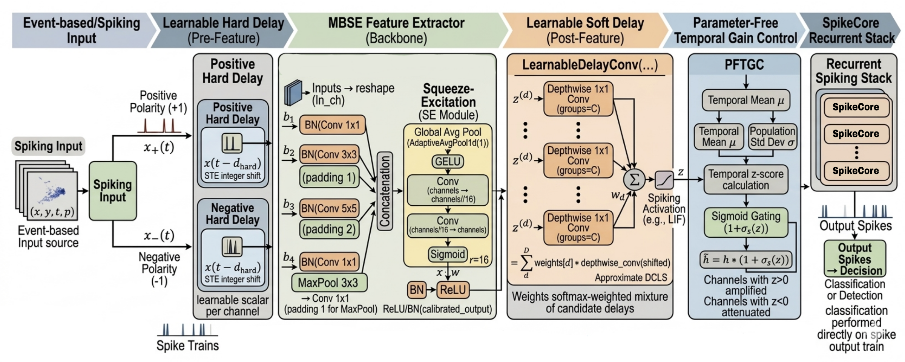

# SpikeCore — NeurIPS 2026


[](https://pytorch.org/)
[](LICENSE)

This repository accompanies the NeurIPS 2026 accepted paper **"Timing Is All You Need: SpikeCore, Learnable Delays, and Gain Control for Neuromorphic Classification"**. It contains the core implementation of the proposed SpikeCore unit and the full SpikeCore-DVS pipeline, evaluated on DVSGesture, Spiking Heidelberg Digits (SHD), and Spiking Speech Commands (SSC).

**Authors:** Mohsen Kamelian Rad, Sotiris Moschoyiannis, Roman Bauer
---
## Architecture


## File Overview

### `SpikeCore.py`
Defines the **SpikeCore unit** — the proposed recurrent spiking module at the heart of the pipeline. This is the primary architectural contribution of the paper. SpikeCore integrates learnable temporal delay mechanisms (hard polarity-level shift and differentiable soft delay mixture), parameter-free temporal gain control (PFTGC), and adaptive membrane dynamics into a self-contained, reusable PyTorch module. This file can be imported independently of the rest of the codebase.

### `backbone.py`
Contains the three full model architectures, one per dataset:

- **DVSGesture** — 2D spatial processing pipeline, operating on event frames; uses 2D convolutions in the MBSE backbone to handle the spatial structure of DVS camera output.
- **SHD** — 1D / temporal pipeline, adapted for audio-derived spike trains from the Heidelberg Digits dataset.
- **SSC** — 1D / temporal pipeline for the larger-scale Spiking Speech Commands benchmark.

All three architectures follow the shared design shown in **Figure 2** of the manuscript (MBSE backbone + PFTGC + Delay +... → SpikeCore stage), with dataset-specific adaptations in input dimensionality, convolution type, and temporal resolution. The SpikeCore unit from `SpikeCore.py` is used identically across all three.

### `spikecore_SSC_run.py`
A self-contained, end-to-end training and evaluation script for the **SSC dataset**. Running this file is the quickest way to reproduce the SSC results reported in the paper. It includes:

- Data loading and preprocessing for SSC
- On-the-fly spike train augmentations (temporal jitter, masking, etc.)
- Model instantiation using the SSC backbone from `backbone.py`
- Full training loop with the exact protocol used in the paper (optimizer, scheduler, loss, early stopping)

See **Usage** below for instructions.

---

## Requirements

```
Python >= 3.9
PyTorch >= 2.0
torchvision
tonic
numpy
tqdm
```

Install dependencies:

```bash
pip install torch tonic numpy tqdm
```

> The experiments require an event-camera data loader (e.g., `tonic`).

---

## Usage

### Quickstart — Reproduce SSC Results

```bash
python spikecore_SSC_run.py
```

This will download/preprocess the SSC dataset (if not already present), train the full SpikeCore-based model, and print per-epoch training, validation, and test accuracies. Expected final accuracy: **~80.1%** (see Table 2 in the paper).


### Using Backbones Directly

Each backbone can be instantiated independently for custom experiments:

```python
from backbone import feature_extractor, feature_extractor_DVS, feature_extractor_SHD

```

### Using SpikeCore as a Standalone Module

SpikeCore can be imported and used outside this pipeline:

```python
from SpikeCore import SpikeCore

config = {
    "unit_type": SpikeCore,
    "unit_args": {
        "activation": StepFunction(),
        "g": F.leaky_relu,
        "decay": 0.9,
        "lambda_value": 0.0,
    },
    "N": [700, 512, 35],    # input_Size, HD size, and output size
    "lr": 0.001,
    "epochs": 200,
}
```

---

## Correspondence to the Paper

| Paper component | Code location |
|---|---|
| SpikeCore unit (Section 3.1, Fig. 1) | `SpikeCore.py` |
| MBSE backbone (Section 3.4) | `backbone.py` — `MBSE` class |
| PFTGC (Section 3.5) | `backbone.py` — `PFTGC` module |
| Learnable delay layers (Section 3.3) | `backbone.py` — `LearnableDelayConv`, `LearnableDelayLayer` |
| Full DVSGesture model | `backbone.py` — `feature_extractor_DVS` |
| Full SHD model | `backbone.py` — `feature_extractor_SHD` |
| Full SSC model + training protocol | `backbone.py` , `spikecore_SSC_run.py` |

---

## Notes

- All experiments were run on a single NVIDIA 3090 (24 GB).
- The codebase uses standard PyTorch throughout; no custom CUDA kernels are required.
- Results may vary slightly from the paper depending on hardware and driver version due to non-determinism in certain CUDA operations, but should be within ±0.3% of reported figures with the provided seed.

## License
This project is licensed under the MIT License. See [LICENSE](LICENSE)
for details.

## Citation
If you use SpikeCore or this code in your research, please cite:

```bibtex
@inproceedings{kamelianrad2026spikecore,
  title     = {Timing Is All You Need: {SpikeCore}, Learnable Delays,
               and Gain Control for Neuromorphic Classification},
  author    = {Kamelian Rad, Mohsen and Moschoyiannis, Sotiris
                and Bauer, Roman},
  booktitle = {Advances in Neural Information Processing Systems},
  year      = {2026}
}
